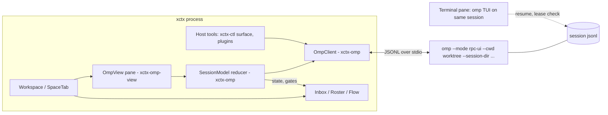

# Native omp agents: the Tern omp experience inside xctx

**Status:** Plan (nothing implemented). Proposed as Milestone 7; not yet in [`roadmap.md`](roadmap.md). Written against
`main` at `5dc5f5f`, omp 19.1.0 (`~/.local/bin/omp`) and Tern 0.9.35 (omp 19.2.1 under its own folder).

## Goal

Today every xctx agent pane is a PTY running omp's terminal UI (`spawn.rs`, `xctx-term-view`). Tern shows omp as a
native chat surface (composer, queue, plan review, ask cards, subagent tray, HUD, overlays) while keeping a plain
terminal available. This plan gives xctx the same surface for omp, for every agent pane and for the Parent Agent, and
uses what the native channel makes possible that a PTY cannot: real agent state for the Roster and Inbox, named and
forkable sessions, and xctx's own tools served to the agent in-process.

Not a goal: replacing the terminal pane. `pi`, `claude`, `codex`, shells, `nvim` and `lazygit` stay PTY panes, and an
omp pane can always be reopened as the terminal UI on the same session.

## What Tern does (evidence)

- Tern is a multiplexing terminal (`tern --help`) that manages its own omp install: `~/Library/Application Support/Tern/omp/`
  (`manager.json`, `versions/19.2.1`, `bin/omp`, linked from `/opt/homebrew/bin/omp`, patched from `~/.local/bin/omp`).
- Its binary carries 734 distinct `omp.*` strings (UI roles and selectors, counted with `strings`) and 41 `--omp-*` theme variables. The roles map one to one onto omp's
  RPC surface (`omp://rpc.md`): `omp.composer.*` (model, effort, send, stop, chips, usage), `omp.queue*` (`queue_update`),
  `omp.ask.*` (the `form` request), `omp.hook-input/editor` (`input`/`editor` requests, with `omp.hook-input.timer`),
  `omp.plan.*`, `omp.review.*`, `omp.tray.*` and `omp.task.*` (subagents), `omp.btw.*` (side questions),
  `omp.jobs.*`, `omp.rewind.*` (`navigate_tree`/`fork`), `omp.compaction`, `omp.login.*`, `omp.usage.*`,
  `omp.overlay.permission`, `omp.hud.*`, `omp.autoresearch.*`, plus modes `bashMode`, `pythonMode`, `btwMode`.
- **[INFERENCE]** Tern drives omp with `--mode rpc-ui`. I could not capture its child's arguments (only an
  `__omp_worker_daemon` process was running), but the roles above only make sense on that protocol.
- Verified on this machine: `omp --mode rpc-ui --no-session` answers `ready`, `negotiate_protocol` (v2),
  `get_state`, `get_available_commands`, `get_session_stats` without any model credentials, and emits
  `extension_ui_request` frames at startup (an `autoresearch` widget).

## What xctx has, and what is missing

| Area | xctx today | Gap |
|---|---|---|
| Agent pane | PTY + `TerminalView`; liveness from the process (`flow.rs::pane_lives`) | no transcript, composer, queue, tool cards |
| Agent state | graph state set by `xctx-ctl`; Roster states are coarse | no `agent_start`/`agent_end`/`session_settled`, no "waiting on you" |
| Sessions | `agent_session.rs` assumes `pi` under `~/.pi/agent/sessions`; `omp.toml` says omp cannot name or fork sessions, so no attempts for omp | RPC has `open_session`, `fork`, `navigate_tree`, `get_state.sessionFile` |
| Talking to agents | `agent.send` types into the terminal; `agent.read` scrapes the screen | `prompt`/`steer`/`follow_up`, transcript read |
| Needs-you | Inbox gates are posted by `xctx-ctl`/plugins | omp's `ask` form, permission and plan prompts never reach the Inbox |
| Tools for agents | agents shell out to `xctx-ctl` (long prompt in `parent_agent.rs`) | `set_host_tools` serves them natively |
| Theme | one xctx palette | omp tokens (`--omp-*`) not mapped |

## Architecture

New crates (workspace picks them up from `crates/`):

- `xctx-omp` (no GPUI): JSONL codec including protocol v2 `rpc_chunk` reassembly, typed commands and frames, the
  child process client, and `SessionModel`, a pure reducer from frames to view state. Everything testable without a window.
- `xctx-omp-view` (GPUI, name ends in `-view`): the pane, composer and overlays, built on `xctx-ui` tokens, `PromptBuffer`
  and the `drag`/`overlay` modules.

Rules for the client (decisions, not options):

1. Threads and channels, no new async runtime: one reader thread, one writer thread, frames to GPUI over a channel
   drained with `cx.spawn`. The reader never blocks on the UI (omp spills to disk under backpressure; we must keep reading).
2. Negotiate v2 immediately when `ready.supportedProtocolVersions` has it; enforce `maxReassembledFrameBytes`.
3. Every frame type is `#[serde(other)]`-tolerant: unknown events become `Frame::Unknown(Value)` and are ignored, so a newer
   omp never breaks the pane. Feature-detect from `ready` and command responses, never from version strings (this machine has 19.1.0 and 19.2.1).
4. `set_event_filter { events: null, messageUpdates: "delta" }` to avoid per-token full-message snapshots; rebuild blocks from deltas and treat `message_end` as authoritative.
5. Responses correlate on `id` only; ordering across commands is not guaranteed (`bash`, `predict_word` run concurrently).
6. Errors are values: spawn failure, EOF, malformed line, `rpc_frame_error`, `session persistence` notices all surface as a banner on the pane, never `unwrap`.
7. Child environment equals today's PTY agent environment (`PORT`, `MISE_ENV`, `XCTX_*`, the `xctx-ctl` socket) so skills and `xctx-ctl` keep working.

## Fit with xctx (what must not break)

Checked against `design/README.md`, `docs/m6.md` and the code. These are requirements on every wave, not extras.

| xctx principle | Source | What it means for a native omp pane |
|---|---|---|
| The pane is the unit the shell moves | M6 drag and drop (`PaneTree::drop_pane`), pane headers, `PaneKind::Agent` | The native pane is pane content under the same `PaneRole`/`PaneId`: it splits, swaps, zooms, reshapes (Dev/Debug/Review) and persists exactly like a terminal pane. Plugin panes (`plugin_panes.rs`) are the precedent for a non-PTY pane. No second layout system. |
| One shell answers needs-me / everyone / steer-this | M6 Roster, Inbox overlay, Flow | The pane never owns state the shell cannot see. Running/idle/blocked/needs-you come from the session model (Wave 5), and every blocking prompt is also an Inbox item. |
| Esc belongs to the focused program (D5) | `m6.md` D5 | In the native composer, Esc interrupts a streaming turn (as omp's TUI does), else clears the draft, and only then falls through to the shell's layered Esc. Never the other way round. |
| Nothing widens without the Plan Gate; nothing is auto-approved | design README 5, Inbox rules | xctx never passes `--auto-approve`, `--approval-mode yolo`, or `--no-ui` with approvals. A permission or `ask` request from omp is answered by the user only; Inbox shows the exact tool and arguments and offers no one-click approve for danger-class calls (same danger-first ordering as the Inbox overlay). Plan Gates stay xctx's; omp's plan mode is the agent's own and is shown, not merged. |
| Secrets stay masked | design README 7, `Redactor` | Everything leaving the pane for xctx state (Inbox titles/bodies, `agent.read`, Flow timeline, channel notes, toasts, logs) goes through `Redactor`. The pane itself shows what the PTY shows today. Session files omp writes are omp's, unchanged. |
| Writers never edit each other's repo; helpers are read-only | design README 4 | `cwd` is the agent's own worktree and `--add-dir` is never used. Helpers start with `--tools` limited to read tools: the invariant becomes enforced instead of briefed. |
| Same environment as every pane | `spawn.rs` (`PORT`, `MISE_ENV`, `XCTX_*`, scratch dir, attempt token, pane `PATH`) | The RPC child gets the environment built by the same function as the PTY (extract the env construction from `spawn.rs` into one shared value; no copy). Anything a terminal agent can reach, the native one reaches, including `xctx-ctl`. |
| Browser lives in the space's browser pane | commit `50c7236`, `agent_skills.rs` | The `--config <skills>/omp-config.yml` overlay (skills dir, `browser.enabled: false`) is passed to the RPC child unchanged. |
| Parent Agent writes no code, advisory only today | `parent_agent.rs` | With host tools (Wave 6) its `bash` is dropped and it gets only read tools plus xctx tools, which makes "writes no code" enforced rather than advisory. |
| Tests never touch real data | `AGENTS.md` | Fake omp binary, temp dirs, `XCTX_DATA_DIR`; real-omp smoke tests are `#[ignore]` and use `--no-session` in a temp cwd. |
| GPUI only in `xctx`, `*-view`, `*-ui` | `AGENTS.md` | `xctx-omp` has no GPUI; `xctx-omp-view` does. Dependencies permissive only (`pulldown-cmark` MIT, `html5ever` MIT/Apache-2.0). |
| Do not copy Zed GPL code (`terminal`, `terminal_view`) | `AGENTS.md` | The transcript list and markdown rendering are written here on `gpui` primitives; nothing from GPL Zed crates. |

## Feature parity map

`C` = core parity, `P` = parity after core, `X` = xctx-specific gain.

| Tern feature | RPC mechanism | Wave |
|---|---|---|
| C Transcript: user, assistant text, thinking, markdown, code | `message_start/update/end`, `get_messages_page` for history | 2 |
| C Tool cards: bash, read, edit diff, write, find/search, eval, task, todo, web, errors | `tool_execution_*`, `tool_stream_update` | 2 |
| C Composer: multiline, send, stop, steer vs follow-up, image paste and drop | `prompt{streamingBehavior,images}`, `abort` | 2 |
| C Queue chips, remove, promote, edit | `queue_update`, `remove_queued_message`, `promote_queued_message`, `abort_and_restore_queue` | 2 |
| C Model picker, effort slider, fast/slow, thinking | `get_model_picker`, `set_model`, `set_thinking_level`, `set_fast_mode`, `set_slow_mode` | 2 |
| C HUD/status: model, context %, cost, tokens/s, git, session name, todo progress, working timer | `get_state`, `get_session_stats`, `todoPhases`, `contextUsage` | 2 |
| C Slash commands and completion; `@file` | `available_commands_update`; **file completion is ours** (RPC has no autocomplete composition) via the files plugin index | 2 |
| C Mode prefixes `!`, `!!`, python, `/btw` with coloured editor border | `bash{excludeFromContext}`, `btw`, `btw_cancel`, `get_btw_history` | 2 |
| C Errors, retry and fallback notices, compaction captions | `prompt_result.error`, `auto_retry_*`, `retry_fallback_*`, `*_compaction_*`, `compact` | 2 |
| C `ask` tool card (HTML form) with constraint validation and "Other" | `extension_ui_request{method:"form"}` + `extension_ui_response{data}` | 3 |
| C Hook dialogs: select, confirm, input (timer, secret), editor, `cancel` | same, `timeout`, `targetId` | 3 |
| C Permission/approval prompts | extension dialogs when tools need approval (omp fails closed under `--no-ui`) | 3 |
| C Plan mode review: document, TOC, approve with model slider, feedback | **unknown frame, spike in 0** | 3 |
| C Subagent tray, peek, cancel, steer | `set_subagent_subscription`, `get_subagents`, `get_subagent_messages`, `cancel_subagent`, `steer_subagent` | 4 |
| P Rewind/branch/fork/tree, handoff, export, rename | `get_tree`, `navigate_tree`, `branch`, `fork`, `handoff`, `export_html`, `set_session_name` | 4 |
| P Jobs overlay, usage report, session info, hotkeys, login/logout | `get_login_providers`, `login`, `open_url`, `usageLimit`; jobs frame **unknown, spike** | 4 |
| P Goal mode, side-question history | `goal`, `goal_updated` | 4 |
| X Agent state to Roster, Flow and Inbox | `agent_start/end`, `session_settled`, pending UI requests | 5 |
| X Named, resumable, forkable omp sessions, so attempts work for omp | `--session-dir`, `open_session`, `fork`, `get_session_lease` | 5 |
| X xctx tools as native agent tools | `set_host_tools`, `set_host_uri_schemes` | 6 |

Decide before building (voice, dictation, `autoresearch`, `spotlight`, `mcpAdd`, setup wizard, `live_*`): see
[Open decisions](#open-decisions). They are not silently dropped; each needs a yes or no.

## Waves

Each wave follows the repo workflow: one writer per worktree, `mise run ci` before every commit, tests use temp
directories and `XCTX_DATA_DIR`, no `unwrap`/`expect` on I/O, doc comments on public items.

### Wave 0: contract spike (no product code)

- Record real transcripts from omp 19.1.0 and 19.2.1 as JSONL fixtures under `crates/xctx-omp/tests/fixtures/`: plain
  turn with tool calls, `ask` form, plan mode enter/approve, permission prompt, subagent run, `btw`, compaction, retry
  and fallback, queue steer, login, a very large frame (v2 chunks).
- Answer, in `docs/omp-native.md` itself, the open protocol questions: how plan review and permission prompts arrive,
  which frame feeds the jobs overlay, `ImageContent` shape, whether `fork` can target another worktree for attempts,
  whether `--config` skills overlay and `--tools` work unchanged in rpc-ui, and what a TUI attach does to a live RPC session (lease).
- A fake `omp` (a small Rust test binary that replays a fixture and echoes commands) is the harness for all later waves.
- Done when: fixtures committed, questions answered with the frames that prove them.

### Wave 1: `xctx-omp` (protocol, client, reducer)

- Codec (v1 lines, v2 chunks), typed commands/frames for everything in the parity map, `OmpClient` (spawn, handshake,
  request/response with timeouts, event stream, graceful close: close stdin, keep reading until EOF).
- `SessionModel`: transcript blocks with stable `messageId`, tool-call lifecycle, queue, todos, goal, context usage,
  pending UI requests, subagent registry, banner state. Pure `fn apply(&mut self, Frame) -> Vec<Effect>`.
- Tests: replay every Wave 0 fixture and assert model snapshots; chunk reassembly edge cases (interleaved, overlong, bad UTF-8); unknown-frame tolerance; EOF mid-turn.
- Done when: `mise run ci` green, a `#[ignore]` real-omp smoke test (`--mode rpc-ui --no-session`, `get_state`) passes locally.

### Wave 2: `xctx-omp-view` (chat surface)

- Transcript as a virtualized list (GPUI `list`), markdown via `pulldown-cmark` (MIT), code blocks and diffs first
  with the existing palette (syntax highlighting is an open decision), tool cards per tool kind, collapsed by default with expand, image thumbnails.
- Composer on `PromptBuffer` (multiline): send/stop, steer vs follow-up while streaming, queue chips with edit and
  remove, model and effort controls, mode borders from theme tokens, slash menu, `@file` completion, image paste and
  drag-and-drop (reuses `xctx-ui/src/drag.rs`).
- HUD row and working indicator (spinner from `xctx-ui/src/spinner.rs`, elapsed, Stop). Welcome/empty state.
- Done when: headless GPUI render tests cover transcript, queue, composer modes and error banner; screenshot of a fixture-driven pane in dark and light.

### Wave 3: dialogs and gates

- `form` renderer: parse the HTML subset (`input` text/number/range/email/url/hidden/radio/checkbox, `select`,
  `textarea`, `fieldset/legend`, `required`, `min/max`, `minlength/maxlength`, `pattern`), enforce every constraint
  client-side before replying (omp fails the whole call on a bad `data`), "Other" rules exactly as in the spec, honour `timeout` and `cancel`.
  HTML parsing uses a permissively licensed parser (`html5ever` MIT/Apache or `tl` MIT); no webview.
- `select/confirm/input/editor` dialogs with countdown, secret masking, `targetId` cancel; permission prompts; plan review overlay per Wave 0 answer.
- Overlay placement reuses `overlays.rs`; every blocking request also posts an Inbox item (kind: ask, permission, plan) so it shows in the Roster and toasts when the pane is not visible, and answering from either place resolves the same request.
- Done when: fixture-driven tests prove validation parity (invalid `data` is never sent), timeout and cancel paths, and Inbox/pane agreement.

### Wave 4: tray, history and the long tail

- Subagent tray with live progress, peek (incremental `get_subagent_messages{fromByte}`), cancel, steer.
- Rewind/branch/fork tree, handoff, compact, export, rename, goal, jobs, usage, session info, login/logout, hotkeys sheet.
- Done when: each overlay has a render test and a fixture replay; `get_state` re-read after `agent_end` and slash commands keeps HUD correct (spec: `usageLimit` has no event).

### Wave 5: integration into spaces

- Runner manifest gains `interface = "terminal" | "rpc"` (default `rpc` for `omp`, `terminal` for others) and `rpc_args`;
  `omp.toml` drops the "cannot name or fork sessions" caveat; `pane_lives`, `PaneTerminal` (add an `Omp` content variant, or rename to a
  pane-content enum) and `spawn.rs` start the client in the agent's worktree with a per-agent `--session-dir`
  under the data directory, record `sessionId`/`sessionFile` on `AgentNode::session`, resume with `open_session`/`--resume`.
- State: `agent_start` -> Running, yield -> Idle, `session_settled` -> done, any pending UI request -> `Blocked{reason}` + Inbox item, retryable error -> Roster badge. Roster and Flow read this instead of process liveness.
- Control socket: `agent.send` becomes `prompt` (or `steer`/`follow_up` while streaming); `agent.read` returns the rendered transcript tail through `Redactor`, same masking as today; both still work for terminal panes.
- Attempts for omp: `fork` into the attempt's session dir (subject to Wave 0 answer), so the caveat in `omp.toml` and the "Fork requires the `pi` runner" note in `m6.md` (Wave 2, `m6-inspector`) go away.
- Terminal escape hatch: "Open in terminal" stops the RPC child and starts `omp --resume <id> --session-dir ...` in a PTY pane; `get_session_lease` guards against two processes owning one session.
- Parent Agent drawer and the dock from the last overhaul switch to the native pane (`--tools read,bash` and its prompt stay as is until Wave 6).
- Done when: `lifecycle_tests` cover open, quit, reopen, resume with the fake omp; crash and EOF restart paths; two panes on distinct sessions.

### Wave 6: host tools and theming

- `set_host_tools`: expose the `xctx-ctl` surface (`space.*`, `agent.*`, `plugin.call`, `inbox.post`, ...) as tools served in-process, then shorten `PARENT_AGENT_PROMPT` and agent skills; keep `xctx-ctl` for non-omp runners. `set_host_uri_schemes` for `xctx://` resources. `set_todos` pre-seeds from the Plan Gate.
- Theme: map the `--omp-*` token set (text, muted, dim, accent, success, warning, error, tool title/output/diff, markdown, syntax, thinking levels, modes) onto `xctx_ui::Theme` for dark and light; translucency and blur from the shell overhaul apply to the pane background.
- Done when: a screenshot of Home and a space with native omp panes matches the theme spec in `m6-theme.md`; host-tool calls are covered by fake-omp tests (call, update, cancel, error).

## Risks

| Risk | Mitigation |
|---|---|
| Protocol drift between omp 19.1.0 and 19.2.1 | tolerant decoding, feature detection, fixtures from both versions in CI |
| Two processes on one session (TUI + RPC) | `get_session_lease` before attach, explicit "held by another omp" state |
| Streaming cost: full message snapshots per token | `messageUpdates: "delta"`, rebuild on `*_end`, virtualized list |
| `form` HTML is arbitrary | strict subset parser, unknown controls render as text input and are reported in the banner; never send data omp will reject |
| Plan/permission/jobs frames unknown | Wave 0 gates Wave 3 and 4; no UI built on guesses |
| Large scope | each wave ships alone behind `interface = "terminal"` fallback; omp stays usable as a PTY throughout |

## Decisions

Taken as the recommended option when the user answered "yes"; overrule any of them and the affected wave changes.

1. **Default interface for `omp` panes**: native; `terminal` stays selectable per runner and as the escape hatch.
2. **Voice and dictation** (`live_*`, `dictation_*`): out. They need a microphone entitlement in `xctx.app`; revisit after Wave 6.
3. **`autoresearch`, `spotlight`, `mcpAdd`, setup wizard**: not ported; "Open in terminal" covers them.
4. **Syntax highlighting**: none in Wave 2 (plain monospace, diff colours only); `syntect` or tree-sitter is a later, separate decision.
5. **omp install**: `omp` on `PATH` first (as `ProgramSearch` does now); Tern's managed copy (`~/Library/Application Support/Tern/omp/bin/omp`) only as a fallback when `PATH` has none.
6. **Roadmap**: Milestone 7 (`docs/roadmap.md` entry added when Wave 1 lands). It does not reopen M6.

## Execution

Intended: a spike agent for Wave 0 and a build agent for the rest. The client rejected subagents
(`Subagents are not implemented by this client`), so the work runs inline, in this order. Status:

| Wave | State |
|---|---|
| 0 contract spike | Done for everything a short model turn can show: fixtures for plain, `ask`, permission, queue, `btw`, slash commands and subagent in `crates/xctx-omp/tests/fixtures` (made by `record/record.py` against a real omp). Plan mode, hook dialogs, compaction, retry, a persisted-session lease and cross-worktree `fork` are still unrecorded. |
| 1 `xctx-omp` | Done: codec (with `rpc_chunk`), commands, tolerant frames, the `SessionModel` reducer, the child-process client, the `ask` form parser and validator, `fake-omp`, replay and pipe tests, and an `#[ignore]` smoke test that passes against Tern's omp 19.2.1. `mise run ci` is green. |
| 2 to 6 | Not started. |

## Findings

Method: `omp --mode rpc-ui` driven by a throwaway script (temp cwd, temp `--session-dir`, no model calls, no login) on
`~/.local/bin/omp` (19.1.0) and Tern's copy (19.2.1), plus `strings` on the 19.2.1 binary, then short model turns recorded as fixtures (see Execution).

| # | Unknown | Result | Consequence |
|---|---|---|---|
| 1 | Plan review over RPC | **UNPROVEN** (unsupported over `rpc-ui` in 19.1.0 & 19.2.1; `plan.jsonl`). Tried: (a) `--config` with `plan.defaultOnStartup: true` + extension `/check-plan-api` -> `extension_ui_request {method:"notify"}` reports `hasSessionModes:false`, `pendingReview:null`, `openPlanReviewResult:false`, `resolveResult:false`, `defaultOnStartup` is ignored (no `plan-mode-context`), and `/plan` is absent from `available_commands_update`. (b) `--plan-yolo` -> enters plan mode (`message_start` `role:"custom"`, `customType:"plan-mode-context"`), writes `local://demo-plan.md`, runs `bash` `"propose demo"`, and auto-approves via `model_changed`, `notice` (`"Plan-yolo: plan approved..."`), and `message_start` (`customType:"plan-yolo-handoff"`) with zero `plan_review_requested`, `plan_review_resolved`, or review `extension_ui_request` frames. Binary inspection confirms `rpc-mode` stubs `openPlanReview`/`resolvePlanReview`/`getPendingPlanReview` and omits `sessionModes`; `plan_review_requested`/`plan_review_resolved` only fire in TUI `InteractiveMode.showPlanReview()`. | Wave 3 cannot bridge interactive plan review in `rpc-ui` via an extension in 19.1.0/19.2.1; interactive plan review needs upstream RPC support or "Open in terminal" (while `--plan-yolo` works headless with `plan-mode-context` / `plan-yolo-handoff` / `notice`). |
| 2 | Permission prompts | `--approval-mode always-ask \| always-ask-cached \| write \| yolo` exists (`tools.approvalMode`); rpc.md says approvals use the extension runner and fail closed under `--no-ui`. **Proven** (`permission.jsonl`): with `--approval-mode always-ask`, omp sends `extension_ui_request` `select` titled `Allow tool: bash\nCommand: echo hi`; answering with a cancel is a deny, the tool ends `Failed` and the model is told it was denied. The mode is inherited from the user's omp config today, for PTY panes too. | xctx passes no approval flag (parity), shows the active mode in the HUD, and Inbox approvals show the exact tool and arguments. If the user's config is `yolo`, xctx warns on the pane; it does not override it silently. |
| 3 | Jobs | `/jobs`, `/session`, `/usage`, `/stats`, `/tools`, `/context`, `/forget-approvals`, `/add-dir` are in `get_available_commands`. RPC has no jobs-list command; `get_state` only has `hasPendingAsyncWork`. **Proven** (`commands.jsonl`): `/jobs`, `/session`, `/usage`, `/tools` and `/context` answer with `agentInvoked:false` and their text arrives as notifications, dressed with terminal colour codes (the model strips them). | Jobs overlay (Wave 4) is limited to what `command_output`/`get_state` give; otherwise "Open in terminal". |
| 4 | Image shape | `{ "type": "image", "mimeType": "image/png", "data": "<base64>" }` (from the `abort_and_restore_queue` example in rpc.md). Not sent to a model. | As planned. |
| 5 | Flags under `rpc-ui` and cross-worktree `fork` | **PROVEN** (`worktree_fork.jsonl`): `--session-dir`, `--config <overlay>` (`browser.enabled: false`), `--tools read,bash` and `--cwd` take effect; `sessionFile` is not on disk until the session persists. Cross-worktree fork: starting in `wt2` and calling RPC `open_session{sessionDir}` or `switch_session{sessionPath}` on a `wt1` session returns `cancelled:true`. Starting in `wt2` with `--cwd wt2 --resume <file1>` and calling RPC `fork` returns `response{command:"fork",data:{cancelled:false}}` (`messageCount:2`), **but `bash{command:"pwd"}` still runs in `wt1`**. Starting with **CLI `--cwd wt2 --session-dir <dir> --fork <file1>`** preserves `messageCount:2` and re-roots `cwd` to `wt2` (`command_output` from `/session` reports `CWD: /tmp/scratch/wt2`; `bash{command:"pwd"}` has `workingDir: "/tmp/scratch/wt2"`). | Wave 5: use one `--session-dir` per agent and record `sessionId`/`sessionFile` after the first persisted turn. Attempts for omp are feasible via CLI `--cwd <attempt_wt> --session-dir <dir> --fork <parent_session_file>` (not via RPC `open_session`/`switch_session` or `--resume` + RPC `fork`, which leave `cwd` on the parent worktree). |
| 6 | Session lease | **PROVEN** (`lease.jsonl`): after a completed persisted turn (`session_settled`), `response{command:"get_session_lease"}` returns `{"held":[sid],"unknown":[]}` in both the owner process and a second `omp` process, and `{"held":[],"unknown":[]}` after the owner closes. **However**, calling `open_session{sessionDir}` from the second process while the owner is still alive **succeeds** (`response{command:"open_session",data:{cancelled:false,resumed:true}}`, `get_state` `messageCount:2`) — `omp` does not reject `open_session` on an active lease. | "Open in terminal" and any reattach MUST check `get_session_lease` and stop the RPC child first (close stdin, wait for exit) before starting another `omp` on that dir; `open_session` alone does not prevent concurrent owners. |
| 7 | 19.1.0 vs 19.2.1 | No difference found in `ready`, `get_state` keys, startup `extension_ui_request setWidget autoresearch` / `available_commands_update`, `openPlanReview` RPC stubs, or recorded behavior on `dialogs`, `retry`, `chunk`, `lease`, and `worktree_fork` (checked on both `~/.local/bin/omp` 19.1.0 and Tern's 19.2.1). | Tolerant decoding still stands; fixtures are recorded from 19.2.1 and verified on 19.1.0 as well. |
| 8 | `rpc_chunk` | **PROVEN** (`chunk.jsonl`): `get_state` (~38 KB), `bash` RPC, `read`, and normal `get_messages_page` calls stay under `maxFrameBytes` (1 MiB). An extension calling `pi.sendMessage({customType:"big",content:"B".repeat(1100000)},{triggerTurn:false})` produces real protocol-v2 `rpc_chunk {chunkId, index, count, byteLength, data}` frames (15 chunks total: 5 each for `rpc-1` `message_start`, `rpc-2` `message_end`, and `rpc-3` `response{command:"get_messages_page"}`, ~1.10 MB reassembled each). | Wire `rpc_chunk` framing matches `xctx_omp::codec::Decoder` verbatim; no decoder changes needed. |
| 9 | Ask form | **Proven** (`ask.jsonl`): `extension_ui_request {method:"form", html}`; the HTML is `<form><fieldset><legend>…</legend><label><input type=radio name=… value=…> Red</label>…`. | `xctx_omp::form` parses and validates it; answers go back as `extension_ui_response {id, data}`. |
| 10 | Subagents | **Proven** (`subagent.jsonl`): `set_subagent_subscription {level:"events"}` makes omp send `subagent_lifecycle {payload:{id, agent, parentToolCallId, status, sessionFile}}`, `subagent_progress {payload:{…, progress:{status, toolCount, tokens, durationMs, recentTools, recentOutput}}}` and `subagent_event {payload:{id, event}}` (the child's own agent events). A retry gets id `ReadAB-2`. `get_subagents` returned an empty list while they ran detached, so the tray is built from the frames. | The tray reads lifecycle and progress; child events never enter the parent transcript. |
| 11 | Handshake order | A client may send `negotiate_protocol` before `ready` arrives; omp buffers it. `xctx-omp` waits for `ready` first. | None. |
| 12 | Hook dialogs | **PROVEN** (`dialogs.jsonl`): extension `/dialogs` emits `extension_ui_request` frames for `method:"select"`, `method:"confirm"`, `method:"input"` (`timeout:200`), `method:"input"` (`secret:true`), `method:"editor"` (`prefill`), `method:"input"` aborted by `AbortSignal`, and `method:"notify"`. Leaving timed or aborted `input` requests unanswered triggers `extension_ui_request {method:"cancel", targetId}`; replies use `extension_ui_response {id, value|confirmed}`. | Wave 3 `UiMethod` dialog, secret masking, countdown, and `cancel{targetId}` handling match real `omp`. |
| 13 | Compaction | **PROVEN** (`compaction.jsonl`): with `compaction.modelThresholdsEnabled: false`, `thresholdTokens: 16500`, `keepRecentTokens: 1`, a padded prompt triggers `auto_compaction_start {reason:"threshold", action:"snapcompact"}`, `notice`, `auto_compaction_end {action:"snapcompact", errorMessage:...}`, then fallback `auto_compaction_start {reason:"threshold", action:"handoff"}` and `auto_compaction_end {action:"handoff", result:{summary, firstKeptEntryId, tokensBefore}}`. `/compact` emits `response{command:"prompt",data:{agentInvoked:false}}`, `manual_compaction_start`, `notice`, `manual_compaction_end {result:{summary, shortSummary, firstKeptEntryId, tokensBefore}}`, and `command_output`. | `SessionModel::compacting` and compaction notices match real frames; fallback `auto_compaction_end` carries `errorMessage` before the next compaction action begins. |
| 14 | Retry and fallback | **PROVEN** (`retry.jsonl`): local HTTP server (`ANTHROPIC_BASE_URL`, `--model anthropic/claude-sonnet-4-5`, `retry.fallbackChains` -> `anthropic/claude-haiku-4-5`) returning HTTP `429` (`rate_limit_error`, `Retry-After: 65`) on sonnet and Anthropic SSE `200` on haiku emits `turn_end` (`stopReason:"error"`, `errorStatus:429`), `model_changed`, `retry_fallback_applied {from, to, role, reason}`, `auto_retry_start {attempt, maxAttempts, delayMs, errorMessage, errorId}`, `agent_end {isTerminal:false, yielded:false}`, the fallback turn, `retry_fallback_succeeded {model, role}`, `auto_retry_end {success:true, attempt:1, retryErrors:[...]}`, and final `agent_end {isTerminal:true, yielded:true}`. (Closed-port and `Retry-After: 0` attempts were absorbed by the SDK or finished without session retry events.) | `SessionModel` non-terminal `agent_end {isTerminal:false, yielded:false}` and `auto_retry_*` / `retry_fallback_*` handling match real `omp`. |

Still to record: plan mode, hook dialogs, compaction, retry, a large frame (a real `rpc_chunk`), a persisted-session lease
and a cross-worktree `fork`. Wave 3 (plan review) and Wave 5 (attempts) stay gated on those.
